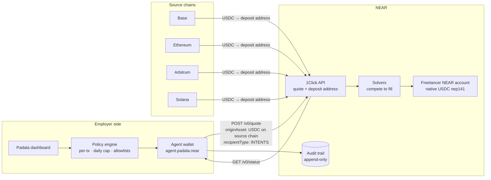

# Padala — Cross-chain payroll on NEAR

> Freelancers invoice in USD. Employers pay USDC from **any chain** through NEAR Intents. Freelancers receive **native USDC on NEAR** in seconds. An **autonomous agent** settles invoices on its own when route fees fit the budget, every payment moves through a **policy-gated agent wallet**, failed swaps refund to **MPC-derived per-invoice addresses** (Chain Signatures), and every decision lands in an append-only audit trail.

**NEAR HACKATHON — Build Beyond Boundaries (Nov 1–14, 2026)**
Tracks: **Real-World Money** · **AI Security & Defense**

---

## Why this matters

Cross-border freelance payment is broken: wires take 3–5 business days, cost $25–50, and freelancers eat the FX spread. Stablecoins fix the asset, but not the rails — clients hold USDC on Ethereum/Base/Solana, freelancers (especially in remittance-heavy markets like the Philippines) need one predictable place to receive it.

Padala is the missing payroll layer:

1. **Freelancer** creates an invoice in USD → a unique refund address is derived for it from the NEAR MPC root key (Chain Signatures) — no keys stored anywhere.
2. **Share the link** — the client opens `/pay/INV-1002`: no login, sees the amount, pays USDC from any chain (QR or address).
3. **The agent wallet** evaluates a spending policy (per-tx limit, daily cap, chain + payee allowlists) *before* a deposit address is ever issued.
4. **NEAR Intents (1Click)** turns "pay $1,800 of USDC" into a single deposit address on the source chain — solvers compete, settlement to NEAR takes ~20–45 s.
5. **Autopilot** — arm it on any invoice and the agent re-quotes every 2 minutes, executing settlement only when the live fee is inside the budget you set. A payment completes with **zero human clicks**; anything over budget is skipped and logged.
6. **Freelancer** receives native USDC (`nep141`) in their NEAR Intents balance. No bank. No wire. ~1% all-in cost.

The agent wallet is the safety story: the employer delegates a *policy*, not their keys, and every decision — pass or block, human or autonomous — lands in an append-only audit trail.

## Autonomous payments (Autopilot)

Most "AI agents" maximize spending. Padala's agent *constrains* it:

- Flip **Autopilot** on an invoice with a max route fee (e.g. ≤ 1.00%).
- A scheduler hits `GET /api/cron/settle` every 2 min (cron-job.org free tier, GitHub Actions, or a curl loop — see below).
- Each tick the agent fetches a **live 1Click quote**, compares the fee to the budget, and either executes the full settlement flow or **skips and logs why** (`AUTOPILOT_SKIPPED — fee 118 bps > budget 100 bps`). It re-quotes next tick instead of overpaying.
- The spending policy still gates every autonomous payment — autopilot never bypasses it.
- Deposits already in flight are never double-quoted (`SKIP_IN_FLIGHT`).

```bash
# run the loop locally — cross-platform worker (Windows/macOS/Linux, no bash needed)
bun run worker
# or: point cron-job.org at https://your-host/api/cron/settle every 2 min
# (set CRON_SECRET to require: Authorization: Bearer <secret>)
```

## Chain Signatures — per-invoice refund addresses

A failed 1Click swap refunds to `refundTo` on the origin chain. Instead of hardcoding an EOA, Padala derives a unique refund address per invoice from the **NEAR MPC network's root key** (`v1.signer`, mainnet) — the private key never exists anywhere: not in this app, not in any TEE, not even on the MPC network itself.

```
tweak = sha3_256("near-mpc-recovery v0.1.0 epsilon derivation:" + signerId + "," + path)   # path: refund-INV-1042
child = root_point + tweak · G          (secp256k1)
addr  = EIP-55( keccak256(child_pub)[12..] )
```

`scripts/verify-derivation.ts` pins this local KDF to output **captured from the live contract** — if the MPC network ever changes its scheme, the test fails loudly instead of deriving addresses the contract wouldn't control:

```bash
bun scripts/verify-derivation.ts
# derived : secp256k1:3b3GS4kaAPvzxFUEYKiMvXeuBzttMZosggT3iAAbyZzAfQc1Dn4eLrDshNGGeKZyfSK7xegjPSq553NXHisMLiyA
# expected: secp256k1:3b3GS4kaAPvzxFUEYKiMvXeuBzttMZosggT3iAAbyZzAfQc1Dn4eLrDshNGGeKZyfSK7xegjPSq553NXHisMLiyA
# PASS — derivation matches the live contract output
```

(That vector is the **testnet child key** for predecessor `derivation-test.testnet` / path `unit-test` — it proves the KDF, it is *not* a key you can pin.) To run derivation **offline on mainnet**, pin the mainnet **root** key in `.env` — `MAINNET_ROOT_NAJ` in `scripts/verify-derivation.ts`, re-verified against the live `v1.signer` contract:

```
MPC_PUBLIC_KEY=secp256k1:3tFRbMqmoa6AAALMrEFAYCEoHcqKxeW38YptwowBVBtXK1vo36HDbUWuR6EZmoK4JcH6HDkNMGGqP1ouV7VZUWya
```

Pin only the root key shown by the live `public_key` query — a rotated key would derive addresses the MPC network no longer controls.

Every derivation is audited (`REFUND_ADDRESS_DERIVED`) with its path and the root key used. EVM chains (Base/Ethereum/Arbitrum) are covered; Solana refunds still use a fallback wallet pending ed25519 derivation.

## Batch payroll — one paste, many invoices, one transaction

Real payroll is never one invoice. **Batch payroll** (dashboard button or `POST /api/payroll-runs`) takes a pasted list — up to 50 freelancers — and creates every invoice atomically:

- **All-or-nothing:** every line is validated first; a typo in line 9 returns `400` with per-line errors and creates nothing.
- **Per-invoice Chain Signatures:** refund addresses derive in parallel waves before any row is written — each invoice gets its own MPC refund address.
- **One transaction:** the run + every invoice commit together, so a failure never leaves a half-created payroll.
- **Policy pre-flight:** the dialog warns live when a line exceeds the per-tx limit or the total exceeds the daily cap — and each settlement is still gated individually at pay time. The run never bypasses the policy.
- **One summary audit event** (`PAYROLL_RUN_CREATED`) with the invoice references and the policy snapshot; every invoice carries the run label as a badge.

```bash
curl -X POST http://localhost:3000/api/payroll-runs \
  -H "Content-Type: application/json" \
  -d '{
    "label": "November contractor payroll",
    "scheduledFor": "2026-11-28",
    "autoSettle": true,
    "maxFeeBps": 100,
    "lines": [
      { "clientName": "Ana Reyes",  "amountUsd": 850,  "freelancerAccount": "ana.padala.near" },
      { "clientName": "Ben Santos", "amountUsd": 1200, "freelancerAccount": "ben.padala.near" }
    ]
  }'
```

## CSV export — the accountant leg

`GET /api/invoices/export` (or the **Export CSV** button) → `padala-invoices-YYYY-MM-DD.csv`. One row per invoice: reference, client, status, created/due/settled dates, settled amount, route fee bps, deposit address, refund path, payroll run. UTF-8 BOM + CRLF so it opens clean in Excel. Every export writes a `CSV_EXPORTED` audit event — even an empty ledger leaves a trace.

## Screenshots

| Dashboard — policy-gated agent treasury | Client payment link (no login) | Real 1Click deposit + QR |
| --- | --- | --- |
|  |  |  |

The client link (`/pay/INV-1002`) is fully public: live 1Click quote, scannable deposit QR, self-updating status timeline — no wallet connect, no login.

## Architecture



**Key request** (verified live against mainnet):

```json
POST https://1click.chaindefuser.com/v0/quote
{
  "swapType": "EXACT_INPUT",
  "slippageTolerance": 100,
  "originAsset": "nep141:base-0x833589fcd6edb6e08f4c7c32d4f71b54bda02913.omft.near",
  "depositType": "ORIGIN_CHAIN",
  "destinationAsset": "nep141:17208628f84f5d6ad33f0da3bbbeb27ffcb398eac501a31bd6ad2011e36133a1",
  "amount": "1800000000",
  "recipient": "maria.padala.near",
  "recipientType": "INTENTS",
  "refundTo": "<employer address on origin chain>",
  "refundType": "ORIGIN_CHAIN",
  "deadline": "<now + 30min>"
}
```

`recipientType: INTENTS` is what credits the freelancer's NEAR Intents balance with native USDC. Note `refundTo` must be a valid address **on the origin chain**.

## What is real vs. demo (honesty table)

| Component | Status |
| --- | --- |
| 1Click live quotes + real per-swap deposit addresses | ✅ Real (Base, Ethereum, Arbitrum, Solana → USDC on NEAR) |
| Deposit status polling (`GET /v0/status`) | ✅ Real — deposit actual USDC and the invoice settles for real |
| Client payment link `/pay/INV-xxxx` (QR, live quote, auto-updating status) | ✅ Real, public, no login |
| Policy engine + append-only audit trail | ✅ Real, enforced server-side on every payment path |
| **Autopilot** (agent settles autonomously within fee budget) | ✅ Real — live quotes, real budget decisions, fully audited (`AUTOPILOT_EXECUTED` / `AUTOPILOT_SKIPPED`) |
| **Chain Signatures** per-invoice MPC refund addresses | ✅ Real — epsilon derivation pinned to live contract output (`bun scripts/verify-derivation.ts`) |
| **Batch payroll** (paste 50 freelancers → atomic run, pre-flight, summary audit) | ✅ Real — verified end-to-end through the UI + 21-step API smoke test |
| **CSV ledger export** (BOM + CRLF, audited) | ✅ Real — `GET /api/invoices/export` |
| Spending-policy editor, treasury accounting, impact analytics | ✅ Real (SQLite; swap Prisma provider for Postgres in prod) |
| Treasury balance | 🟡 Demo pool of 12,500 USDC; settled payments decrement it |
| "Simulate settlement" button | 🟡 Demo-only, clearly labeled, audited as `SETTLED (DEMO)` |
| Solana refund address | 🟡 Fallback wallet; ed25519 MPC derivation is the next step |
| Agent identity in a TEE (Shade Agent) | 🟡 Represented server-side; TEE deployment is the production step |

## Repo map

```
src/
├── app/
│   ├── page.tsx                     # single-page dashboard
│   ├── pay/[reference]/             # PUBLIC client payment link (QR + live status)
│   └── api/
│       ├── chains/                  # supported funding chains
│       ├── demo/reset/              # POST: wipe + re-seed the pristine demo (secret-gated)
│       ├── invoices/                # list + create invoices (derives MPC refund address)
│       ├── invoices/[id]/           # PATCH: toggle Autopilot / fee budget
│       ├── invoices/[id]/pay/       # policy gate → quote → payment (the core route)
│       ├── invoices/export/         # GET → CSV ledger export (accountant-friendly)
│       ├── payroll-runs/            # batch invoicing: all-or-nothing + pre-flight + summary audit
│       ├── cron/settle/             # Autopilot: quote → budget check → autonomous settlement
│       ├── payments/[id]/status/    # live 1Click status polling
│       ├── payments/[id]/simulate/  # demo-only settlement for judging
│       ├── policy/                  # get/update spending policy
│       ├── audit/                   # append-only audit trail
│       ├── treasury/                # agent wallet stats
│       └── stats/                   # impact analytics (settle time, cost vs wire)
├── lib/
│   ├── intents.ts                   # 1Click client (verified request/response shapes)
│   ├── chainsignatures.ts           # MPC epsilon derivation → per-invoice refund addresses
│   ├── settlement.ts                # shared policy→quote→payment flow (human + autopilot)
│   ├── invoicing.ts                 # shared invoice validation/creation (single + batch)
│   ├── policy.ts                    # pure policy engine — 6 checks, PASS/BLOCK decision
│   ├── treasury.ts                  # agent identity, balance math, idempotent seed
│   ├── reset.ts                     # wipe + re-seed helper (CLI + /api/demo/reset)
│   └── audit.ts                     # audit writer
└── components/padala/               # dashboard UI (invoices, batch payroll, treasury, audit, architecture)
prisma/schema.prisma                 # Invoice · Payment · Policy · AuditEvent · PayrollRun
scripts/setup.ts                     # bun run setup → .env + client + tables, self-repairing
scripts/verify-derivation.ts         # MPC KDF vs live contract test vector
scripts/worker-loop.ts               # bun run worker → local Autopilot loop (2-min ticks)
scripts/smoke.ts                     # 21-step end-to-end API smoke test
scripts/reset-demo.ts                # wipe + re-seed to the pristine demo state
Dockerfile · fly.toml · render.yaml · HOSTING.md   # production hosting — see "Host it for judges"
tests/policy.test.ts                 # 6-check policy engine at its boundaries (bun test)
tests/invoicing.test.ts              # shared validation + batch parse/pre-flight tests
```

## Run it

```bash
bun install
bun run setup        # idempotent: writes .env, generates the Prisma client, creates the SQLite tables
bun run dev          # http://localhost:3000
```

- **Do:** open `http://localhost:3000/api/health` — **see:** `"ok": true` with a diagnosis. If anything is broken, this endpoint names the exact cause and the fix instead of failing silently.
- No sign-up, no keys, no faucet. The only network calls are public NEAR RPC reads and live 1Click quote requests.
- `bun run setup` is safe to re-run any time and pins the `.env` database path even if your shell already exports a `DATABASE_URL` (CI/containers).
- The DB seeds itself with a paid invoice (INV-1001) and one awaiting payment (INV-1002) so the dashboard tells a story immediately.

Automated checks (the same ones the demo was verified with):

```bash
bun test                    # 30 unit tests — 6-check policy engine boundaries + shared invoice validation
bun scripts/smoke.ts        # 21-step end-to-end API walk of the demo path; resets the demo data when done
bun scripts/reset-demo.ts   # wipe + re-seed to the pristine 2-invoice story
```

For hosted demos: `POST /api/demo/reset` restores the pristine seed remotely (set `CRON_SECRET` or `DEMO_RESET_SECRET` to require `Authorization: Bearer <secret>`).

> **Dashboard stuck on "Loading treasury…"?** That's a skipped setup step, not a bug: re-run `bun run setup` (it repairs `.env`, regenerates the Prisma client and creates tables in one shot), then restart `bun run dev`. If it still fails, `http://localhost:3000/api/health` names the exact cause and fix. First load can take ~10 s while the app derives MPC refund addresses from the live NEAR RPC.

> **Smoke fails at "refund address derived" / "pay" on your machine?** The app is fine — that machine can't reach NEAR RPC and/or the 1Click API (firewall, VPN, antivirus, captive portal). Open `/api/health`: the `network` section names the unreachable API with a fix. Refund derivation can also run fully offline by pinning `MPC_PUBLIC_KEY=secp256k1:3tFR…` in `.env` (the **mainnet root key** — `MAINNET_ROOT_NAJ` in `scripts/verify-derivation.ts`, verified live against `v1.signer`); live quotes always need network.

Optional sanity check (offline, pinned test vector): `bun scripts/verify-derivation.ts`

## Host it for judges

Want judges to click the app instead of cloning it? The repo ships a production Dockerfile plus `fly.toml` / `render.yaml` — one command deploys with a persistent SQLite volume and a `/api/health` health check:

```bash
fly launch --copy-config --no-deploy
fly volumes create padala_db 1 --region sin
fly secrets set CRON_SECRET=$(openssl rand -hex 24)   # gates /api/cron/settle + /api/demo/reset
fly deploy
```

Full walkthrough (Railway/Render/VPS, external Autopilot cron, judge preflight): **[HOSTING.md](HOSTING.md)**.

## 10-day build plan (Nov 4 → Nov 14 deadline)

| Day | Goal | Done when |
| --- | --- | --- |
| **4** | ✅ Scaffold: dashboard, invoices, policy engine, live 1Click quotes, audit trail, simulate button + **client payment links, impact analytics** | Shipped day 1 |
| **5** | Real settlement path E2E: send a small real deposit (e.g. 10 USDC on Base) → watch status flip PENDING → SUCCESS → invoice PAID | One real on-chain settlement on video |
| **6** | ✅ **Chain Signatures refunds** (MPC epsilon derivation, live-verified) + ✅ **Autopilot** autonomous settlement loop | Both shipped early — see features above |
| **7** | **Shade Agent** (NearDeFi/shade-agent-template, Phala Cloud): move the policy engine inside the TEE; quote + sign requests attestable | Policy runs in TEE; attestation quoted in audit |
| **8** | ✅ Recurring payroll runs: batch invoices, per-line validation, policy pre-flight, summary audit event | Shipped — UI + API verified, smoke-tested |
| **9** | ✅ Design pass: payment-link page for the client (no login) — a stranger can pay an invoice unaided | Shipped |
| **10** | ✅ Analytics: average settle time, cost vs. wire, volume for the demo video | Numbers on the landing panel |
| **11** | ✅ README + demo video, plus submission hardening: `bun run setup` bootstrap, batch payroll + CSV export E2E, 30 unit tests, 21-step smoke, demo-reset endpoint, cold-clone simulation | This README; video attached to the X post |
| **12–13** | Buffer: testnet dry-run, fix flakiness, tighten copy, prep the X post thread | Cold-start demo works first try |
| **14** | Submit: repo + X post + 20–2,000 char description before **23:59 UTC** | Submitted early |

## Submission checklist (from nearhackathon.com)

- [ ] Working prototype in a **public repo** (AI judges auto-verify it runs)
- [ ] Demo post on X that **mentions "NEAR HACKATHON"**, tags **@NEARProtocol**, uses **#NEARHackathon**, with demo video or screenshots
- [ ] 20–2,000 character description of what was built (start with the problem, not the tech)
- [ ] Submit both links before **Nov 14, 2026, 23:59 UTC**

Suggested X copy (submission format — fits 280):

> Just submitted Padala for the 2026 #NEARHackathon! 🚀
> I built a cross-chain payroll agent — freelancers get paid in native USDC on NEAR in ~40s, not 3–5 days. Any chain in, policy-gated out.
> Entering the Real-World Money track. Watch the live demo below! 👇
> @NEARProtocol

Attach the demo video below the post. Longer quote-post alternative:

> Freelancers shouldn't wait 3–5 days and $50 in wires to get paid.
>
> Padala: invoice in USD → client pays USDC from Base/ETH/Solana → freelancer gets native USDC on NEAR in ~30s. Every payment passes a policy-gated agent wallet — per-tx limits, daily caps, allowlists — with an append-only audit trail.
>
> Built for NEAR HACKATHON @NEARProtocol #NEARHackathon
> Real 1Click quotes, real deposit addresses, real status polling. 🧵👇

## Production roadmap

- **Chain Signatures signing** (next): the agent won't just derive refund addresses — it will *sign* origin-chain refunds via `v1.signer`, so a failed swap refunds itself with no EOA anywhere.
- **Shade Agents (TEE/Phala / NEAR AI Cloud)**: the policy engine runs inside Intel TDX, its code hash attested on-chain — the employer verifies *what code* guards their money.
- **On-chain audit**: mirror `AuditEvent` hashes to a NEAR contract for tamper-evidence.
- **Local rails**: cash-out leg via licensed off-ramps (e.g. PHP GCASH corridors) — the "last mile" that makes this Real-World Money.

## Stack

Next.js 16 (App Router) · TypeScript · Tailwind 4 · shadcn/ui · Prisma (SQLite) · NEAR Intents 1Click API · NEAR Chain Signatures (MPC epsilon derivation via @noble/curves + @noble/hashes)
